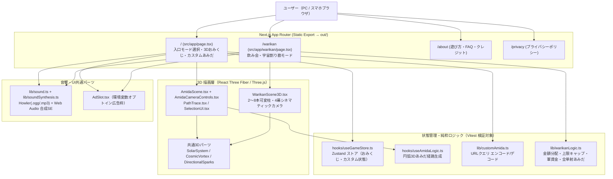
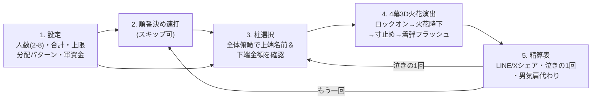

# Cosmic Amida — Architecture & ADRs

> **このドキュメントの目的**  
> コードを読めば分かる詳細（関数仕様など）は書かず、**「全体の地図（関係図）」** と **「なぜこの設計にしたか（ADR・不変条件）」** のみを簡潔に記録します。人間・AI エージェント双方が最小コストで全体像を把握し、陳腐化しにくい状態を保つことが狙いです。

---

## 1. 全体構成・モジュール関係図

---

## 2. 宇宙割り勘モード（`/warikan`）の体験フロー

---

## 3. 主要ディレクトリの責務

| パス | 責務 |
|---|---|
| `src/app/` | Next.js App Router の各ページ（`/`, `/warikan`, `/about`, `/privacy`）と共通レイアウト（OGP・Analytics/AdSense フック） |
| `src/app/_components/` | トップ（おみくじ・カスタム）用コンポーネントおよび共通 3D パーツ（`SolarSystem`, `CosmicVortex`, `DirectionalSparks`, `AdSlot`） |
| `src/app/warikan/_components/` | 宇宙割り勘モード専用の UI フロー（`WarikanApp.tsx`）と 3D シーン（`WarikanScene3D.tsx`） |
| `src/hooks/` | Zustand ストア（`useGameStore.ts`）、おみだ経路計算（`useAmidaLogic.ts`）、Reduced Motion 検知 |
| `src/lib/` | UI 非依存の純粋ロジック（`warikanLogic.ts`, `customAmida.ts`, `amidaConfig.ts`, `fortuneMessages.ts`）と音響制御（`sound.ts`, `soundSynthesis.ts`） |
| `public/` | 静的アセット（NASA ACRIMSAT `.glb`, 惑星テクスチャ, `.ogg`/`.mp3` 音声, `og-image.png`, `robots.txt`, `sitemap.xml`） |
| `e2e/` | Playwright E2E テスト（ローカルおよび本番 URL 検証用） |

---

## 4. 主要な設計判断（ADR 要約）

### ADR-001: Cloudflare Pages 静的出力（`output: "export"`）の採用
- **Status**: Accepted（2026-11-22）
- **Context**: 無料かつ商用利用可能な環境で公開し、維持コストをゼロに抑えたい。
- **Decision**: `next.config.mjs` で `output: "export"`・`images: { unoptimized: true }` を採用し、`out/` を Cloudflare Pages へ配信する。
- **Consequences**: サーバーサイド API Route や SSR 動的生成は使用しない。カスタムあみだの共有は URL クエリパラメータ（クライアント復元）で完結させる。

### ADR-002: 3D 降下進捗の `Ref` 直接駆動とフレームレート非依存補間
- **Status**: Accepted（2026-11-23）
- **Context**: 60fps/120fps で変化する玉の進捗（`progress`）を React `useState` で管理すると、毎フレーム React ツリー全体が再レンダリングされてカクつきやテストタイムアウトを招く。
- **Decision**: 毎フレーム変化する `traceProgress` は `MutableRefObject<number>` で渡し、Three.js の `useFrame` 内から直接参照する。玉・カメラの補間にはすべてフレームレート非依存の `THREE.MathUtils.damp` を使用する。
- **Consequences**: 60Hz/120Hz/モバイル環境いずれでも React 再レンダリングゼロで滑らかに動作する。フェーズ切替（`lockon` / `descending` / `feint` / `landed`）など離散的な状態のみ `useState` を使う。

### ADR-003: 割り勘・あみだロジックの純粋関数分離と数学的不変条件
- **Status**: Accepted（2026-11-22）
- **Context**: お金に関わる計算（上限キャップ・1人無料・ランダム傾斜・切り上げ軍資金）のバグは現場で致命的になる。
- **Decision**: 金額計算とあみだ生成を UI から完全に切り離し `src/lib/warikanLogic.ts` の純粋関数として実装し、Vitest で以下を常時検証する。
  1. `sum(amounts) === totalAmount`（1円もズレない）
  2. 上限キャップ指定時、数学的に可能な限り全員 `amount <= maxPerPerson` を厳守
  3. 切り上げ精算（2次会軍資金）時、`0円`（タダ飯）は `0円` のまま保護
  4. あみだくじの `startToGoal` は 2〜8 人すべてで 1 対 1 対応（全単射）

### ADR-004: 音声の圧縮フォーマット化＋Web Audio API プロシージャル合成
- **Status**: Accepted（2026-11-22）
- **Context**: 初回ロード軽量化と、効果音追加時のアセット肥大化防止を両立したい。
- **Decision**: 既存 `.wav`（646 KB）を `.ogg`（26 KB）＋`.mp3`（121 KB）へ変換してフォールバック配信し、寸止めタメ音・ズッコケ音・ジングル等の演出 SE は `soundSynthesis.ts` の Web Audio API 合成（追加容量 0 KB）で鳴らす。

### ADR-005: 広告・Web Analytics の環境変数オプトイン設計
- **Status**: Accepted（2026-11-22）
- **Context**: 審査前・ローカル開発時に未設定の広告タグがコンソールエラーやレイアウト崩れを起こすのを防ぎたい。
- **Decision**: `NEXT_PUBLIC_CF_BEACON_TOKEN`・`NEXT_PUBLIC_ADSENSE_CLIENT`・`NEXT_PUBLIC_ADSENSE_SLOT_RESULT` が設定された場合のみスクリプトおよび `AdSlot.tsx` を描画する。

---

## 5. AI エージェント・将来の開発者向け「壊してはいけない制約」

- **静的出力の維持**: `next.config.mjs` の `output: "export"` を壊す機能（サーバー専用 API Route や動的 SSR）を持ち込まない。
- **3D パフォーマンス**: `useFrame` 内で毎フレーム `setState` を呼ばない。`<Html>` ラベルには `pointerEvents: "none"` を付け、HUD のクリックを阻害しない。
- **Framer Motion の中央揃え**: `motion.*` 要素に Tailwind の `-translate-x-1/2` を直接付けない（Framer Motion が `transform` を上書きするため、外側の `flex justify-center` ラッパーで中央揃えする）。
- **テスト通過を完了条件にする**: ロジック変更時は `npm run test`、ビルド確認は `npm run build`、公開後は `PLAYWRIGHT_BASE_URL=https://cosmic-amida.pages.dev npx playwright test` で回帰がないことを確認する。
- **別リポジトリの保護**: 元の Vercel 版（`20260203_amida_happy_everyone`）は一切変更しない。
